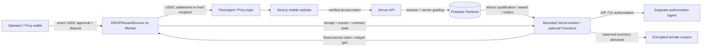

# DROP architecture

**Final submission:** Consumer Products & Payments + **Privy** is **READY FOR JUDGING**, re-submission confirmed `2026-10-13T16:57:26.785Z` (Oct14 01:57 KST); portal Save16:56UTC7/7. Initial primary confirmation: `2026-10-13T16:39:30.988Z`. Required Privy integration description:1,808characters. Separate optional Privy video omitted. Actual wallet creation/creator contract transactions are verified; DROP pays receiving gas through its own relayer, not Privy sponsorship. `acf5b73` is the deployed app baseline; same-human technical accounts are not traction.

DROP is an independent mobile website shared through ordinary HTTPS links in Telegram. It is not a Telegram Mini App. Privy supplies one authentication account and an embedded Ethereum wallet; no Telegram `initData`, wallet seed collection, or duplicate login is used.

## Web and authentication

`src/server/auth.ts` uses the pinned Privy server SDK to verify access-token signatures, issuer, application audience and expiry. It fetches the verified user's Privy profile and derives the recipient from the linked Privy Ethereum wallet. Request-body user IDs, Telegram IDs, success flags and wallet addresses never establish identity. A transactionally reserved walletOwners document prevents one embedded wallet from being attached to multiple application accounts. The pinned `@privy-io/server-auth` 1.32.5 SDK is a compatible legacy SDK; it is deprecated and is not described as the newest maintained Privy SDK.

The deployed free architecture places Next.js and its APIs on Vercel Hobby, durable state in Firebase Firestore/Spark, and bounded payout work after eligible authenticated requests. A protected once-daily route provides capped recovery. Optional Firestore-triggered/scheduled Functions source remains prepared but is not deployed on Spark. The public practice game needs no account and has no award path. Real reward attempts require authentication and a persisted wallet. An unconfigured service fails explicitly; the app never switches to a fake identity, local store or pretend payout. Firestore client rules deny direct reads/writes; server APIs enforce verified Privy identity and tenant ownership.

Production Firestore access explicitly selects `FIREBASE_CREDENTIAL_MODE=vercel-oidc`. The official Vercel SDK supplies a current short-lived OIDC token to Google's external-account credential refresh; the GCP trust is scoped to the production project subject and impersonates the selected same-project runtime service account. No service-account private key is generated for this path, and tokens are neither stored nor logged. Existing ADC, private certificate and isolated emulator paths remain supported. Privy's production login is email/Google; actual Google onboarding is verified. [Federation/runtime setup](FIREBASE_VERCEL.md).

## Immutable campaigns and verification

Campaign creation fixes the game configuration, reward amount, quantity, server policy, attempts and deadlines. There is no API to modify these rules after creation. A salted private quiz commitment prevents brute-forcing a three-answer quiz from its public `rulesHash`; public metadata contains questions and options only. Answers can be retrieved from the public answer-release endpoint only after the event ends.

Catch sessions receive a random nonce and movement seed, configuration version and server timestamps. The browser submits normalized coordinates and elapsed input times. The server recomputes target positions and verifies order, bounds, hit count and minimum time gaps against server-observed elapsed time. Client-reported score is not accepted. Quiz answers are graded from the private server record. These controls validate game consistency, not humanity or complete bot resistance.

The creator UI defaults closing to seven days from creation and receipt deadline to fourteen days, with all three dates visible in the final review. The public event reevaluates its display every five seconds without refetching the rules, so opening/closing changes do not require a refresh. That client clock controls presentation only; session creation and submission still use authoritative server times and immutable campaign rules.

## Atomic first-N allocation

Firestore server transactions read and update the campaign allocation document to establish the authoritative completion order. Submission consumes its one-time session, persists a Qualification, assigns a sequential slot, inserts the Award and payoutJobs outbox, and reserves a unique coupon when appropriate. All award allocation changes commit together. Deterministic claim documents created within that same transaction enforce one campaign award per account, wallet, participant nullifier and slot. Conflicting transactions retry against the newly committed campaign count.

No authorization is signed until the award and outbox have committed. Its recipient, reward ID, slot, amount, campaign, nullifier and deadlines remain fixed across retries. Public `remaining` means unreserved allocations. It is distinct from escrow funds awaiting settlement and from confirmed payouts.

After the first production payout, an actual repeat attempt was rejected by the account/wallet guard and no second award was created. A refresh retained the Paid receipt and balance. These are live observations for one technical account, alongside the separate real-emulator contention tests.

## Escrow and settlement

The default network is Monad Testnet, chain 10143. Server configuration only allows Circle's official per-network USDC address. Before funding or payout, the server checks chain ID, deployed token and escrow bytecode and six token decimals. Funding opens participation only after a successful deposit receipt, the exact CampaignFunded event and immutable contract state agree with the database **at a finalized chain snapshot**.

`receiptFinalizedAt` obtains the provider's `finalized` block, requires `finalizedHeight - receiptHeight + 1 >= DROP_CONFIRMATIONS`, and compares the receipt's block hash with the canonical header fetched at that receipt height. A missing finalized header, provisional receipt or non-canonical hash cannot confirm a payment. Funding, reward and refund verification then read the escrow at the returned finalized block number. The configured depth is measured from the finalized head; advancing `latest` or `pending` is insufficient. The provider remains a trust dependency; these checks are not an independent consensus client.

The operator approves the exact budget and creates the campaign from their own wallet. The escrow stores the original owner, authorization signer, token, fixed reward, maximum recipients, event times and rules hash. `RewardAuthorization` binds the chain and escrow through EIP-712 domain `DROPRewardEscrow`, version `1`. The independent relayer pays MON gas for a narrowly constructed escrow `claim` call. Funds always move from the campaign escrow to the signed recipient.

Unused funds are recoverable by the original owner only after the claim deadline. The app prepares that fixed contract call; the operator approves it. A separate confirmation endpoint checks the canonical finalized receipt, matching campaign/owner/token/refund event, and finalized accounting. Its Firestore transaction updates settlement fields without overwriting a newer reservation counter. Merely reaching the deadline does not execute recovery.

## Worker durability and recovery

The Functions source defines a payoutJobs creation trigger, a one-minute retry/expired-lease scanner and a ten-minute reconciliation schedule. These are prepared entry points, not deployed services. The free production mode uses Next `after()` after successful authenticated reward-list, game-submit and reward-retry responses. It captures the verified principal and only processes that user's award; a persistent 15-second dispatch throttle allows at most one job per invocation. Automatic scanning considers the latest eight awards, while explicit retry can target an older owned award. No public status request or detached browser timer dispatches payouts.

The protected daily Vercel route requires a constant-time-checked private `CRON_SECRET` of at least 32 characters. A durable daily lease/cooldown permits at most three job attempts and three expired-award probes per accepted invocation. A soft 25-second budget, immediate receipt checks and one historical page per request fit the bounded runtime; an in-flight RPC may exceed the soft budget, and the route platform limit is 60 seconds. The scheduled cadence is once daily at 03:00 UTC, within Hobby's permitted frequency and timing tolerance. This is a small-pilot fallback, not an unlimited fair queue consumer or continuously running worker. [Vercel cron limits](https://vercel.com/docs/cron-jobs/usage-and-pricing).

Every job lease is obtained transactionally, and every post-network write checks current ownership and terminal award state. Interrupted jobs retain persisted state and become available after lease expiry. A transactionally updated relayer nonce document serializes allocation across instances. Data/outbox durability does not guarantee continuous execution. `pnpm worker` remains an optional local/supervised entry point for the same engine; no production host for that separate process is claimed.

The worker signs transaction bytes and persists those bytes and their actual hash before broadcasting. External/Functions execution may wait up to 15 seconds for a receipt; bounded request execution checks immediately and yields when still pending. Both apply the same canonical/finalized settlement rules and preserve the outbox on timeout. A hash alone never means confirmed. `RewardPaid` must match campaign, reward, recipient, token, amount, slot and nullifier; the escrow enforces signature, timing and rules-hash binding. `isRewardClaimed` must agree at the finalized state snapshot.

Recovery checks stored settlement, broadcast and replacement hashes **before** historical logs, so an archive-query failure cannot block a known receipt. If finalized state says the reward was paid but its transaction is unknown, the worker scans backwards from a finalized head toward the funding block. Each request covers at most 100 blocks; the default external tick reads at most three pages, while bounded request/daily work uses one. Each page persists `recoveryCursor`, plus `settlementTxHash` when found, under the current lease. Restarts continue from that cursor or check the saved hash first. Exhausted/unavailable history remains a recovery error; it never becomes fabricated confirmation.

A stalled transaction can receive a fee replacement with the same nonce, fixed authorization and gas limit. The worker retains every candidate hash for that nonce. If a proposed replacement exceeds the fee or transaction-cost cap, it can rebroadcast the original stored transaction only if that original still satisfies the current caps. A newly tightened cap is never bypassed. After a consumed transaction needs a fresh nonce, the prior nonce's history moves into an audit record rather than being mistaken for receipts of the new nonce.

Prepared nonces remain tracked even if the award expires or is claimed directly. The worker keeps the job open and rebroadcasts a permitted stored transaction until its nonce is consumed; an expired claim can revert while still consuming that nonce. A direct payment may confirm the Award while its relayer job remains open solely to drain the prepared nonce. Consumption is checked with the relayer's transaction count at `finalizedHeight - (DROP_CONFIRMATIONS - 1)`, not a speculative latest count. Provider/gas/cap failures can still prevent progress and require operator resolution.

`pnpm worker -- --reconcile` compares deposits, paid/refunded amounts at a finalized escrow snapshot, confirmed database amounts and pending reservations. It records the result and reschedules pending receipt checks. It can reopen an expired completed job when finalized contract state proves that a valid direct claim settled, so a server wall-clock expiry cannot permanently hide a real payment. The equivalent direct script invocation is `pnpm exec tsx scripts/worker.ts --reconcile`. Recovery proofs are available only to the authenticated winner once the durable proof has been created. They contain a fixed recipient and can be submitted manually; manual submission may require MON gas. Missing historical receipts may require an archive-capable provider or an actual transaction record supplied through private operations.

## Coupons and transfers

Coupon inventory is imported only into a draft event by its owner. Full promised inventory must exist before publication. AES-256-GCM encrypts payloads with the campaign ID as authenticated context; keyed reference hashes enforce inventory deduplication. Coupon reservation commits alongside its Award. The worker marks delivery, and only that winner can request the private content. Sensitive HTTP responses must be `Cache-Control: private, no-store` and must never enter logs, analytics or public asset directories.

Delivery and viewing do not prove store redemption. `COUPON_DEMO` payloads visibly say they cannot be redeemed. Giftishow API issuance and USDC-to-fiat purchasing are not implemented. External USDC transfer uses the participant's selected Privy wallet, explicit chain 10143 and visible cancellable approval; relayer keys have no withdrawal authority over recipient wallets. With sponsorship disabled, sending/funding/refunding uses wallet-paid test MON. Genuine sponsorship requires separate provider setup/policy/budget, not merely a public flag.

The outgoing-transfer client waits for finalized receipt coverage and checks the canonical block hash. It displays completion only for a successful receipt containing a USDC `Transfer` from the displayed wallet to the approved recipient for the exact integer amount. Actual zero-MON receiving is verified for one reward; outgoing transfer and sponsorship remain separate, unverified live branches.

## Persistence and operations

Document types live in `src/server/db.ts`. Server-only collections include users, walletOwners, campaigns, campaignSlugs, campaignSecrets, gameSessions, qualifications, awards, payoutJobs, coupons, relayerNonces, workerWakeups, recoveryRuns, analyticsEvents, auditLogs and rateLimits. Composite indexes are in `firestore.indexes.json`; all processors share the selected project/database. Production Vercel uses keyless federation. Prepared Functions would use its runtime account and Secret Manager declarations, but is not deployed. Private variables remain separate for Privy, authorization signing, relaying, nullifier privacy and coupon encryption; no raw key/token/account object belongs in logs or public artifacts. Local, testnet and mainnet data/keys are separated. Mainnet remains disabled.

Service configuration booleans report availability only, not proof of a successful external connection. Actual network verification and funding receipts are stronger evidence. Integration status and submission documents separately record which checks have actually run.

## Current deployment boundary

As of **2026-10-14 (Asia/Seoul)**, production acf5b73 is READY at [DROP](https://drop-omega-five.vercel.app/). Project `drop-5a400` has `(default)` Standard/Native Firestore in `asia-northeast3`, deployed rules/indexes and working production WIF access. Actual Google/Privy authentication, creator funding and participant quiz-to-Paid receipt were observed through the app. Independent finalized chain reads verified the 5 test USDC deposit and one 0.1 test USDC payout, including exact authorization/events/state and participant USDC 0→0.1 with MON unchanged at 0. [Funding proof](../contracts/deployment/live-campaign-funding.public.json), [payment proof](../contracts/deployment/live-participant-payment.public.json).

Subsequent sign-out/re-login retained Paid. The separately funded20-slot Catch judge event also produced actual Paid/0.1 in the app, combined wallet0.2 and19remaining allocations; independent catch-payment proof is verified. [Judge funding](../contracts/deployment/judge-event-funding.public.json), [actual catch receipt](https://testnet.monadvision.com/tx/0xbd8d5ce90d6d059931f19050744b546567215f337532a59fa8a481fe4d15ce6e). Both tests use the same human's technical accounts, not two independent participants.

The project remains on **Spark** and the website on **Hobby**. Functions requires Blaze, so its prepared trigger/scheduler is **not deployed**. The bounded request-assisted processor did execute the real payout; daily invocation and live restart/outage recovery are not yet observed. No plan upgrade, minute-scheduled service or unlimited processing is claimed. The technical creator/participant accounts are controlled by one human, not independent-user traction. The earlier unconfigured/no-public-escrow status is historical. [Functions deployment prerequisite](https://firebase.google.com/docs/functions/get-started).

The detailed evidence and open integration gates are maintained in [INTEGRATION_STATUS.md](INTEGRATION_STATUS.md) and [DEPLOYMENT.md](DEPLOYMENT.md).
