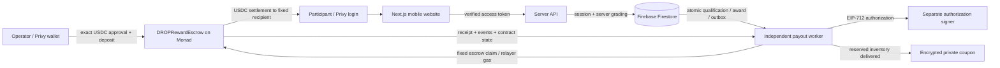

# DROP architecture

DROP is an independent mobile website shared through ordinary HTTPS links in Telegram. It is not a Telegram Mini App. Privy supplies one authentication account and an embedded Ethereum wallet; no Telegram `initData`, wallet seed collection, or duplicate login is used.

## Web and authentication

`src/server/auth.ts` uses the pinned Privy server SDK to verify access-token signatures, issuer, application audience and expiry. It fetches the verified user's Privy profile and derives the recipient from the linked Privy Ethereum wallet. Request-body user IDs, Telegram IDs, success flags and wallet addresses never establish identity. A transactionally reserved walletOwners document prevents one embedded wallet from being attached to multiple application accounts. The pinned `@privy-io/server-auth` 1.32.5 SDK is a compatible legacy SDK; it is deprecated and is not described as the newest maintained Privy SDK.

The target architecture places the Next.js website and server APIs on Vercel, durable state in Firebase Firestore, and payout processing in Firebase Functions. This describes source responsibilities, not a claim that all services are deployed. The public practice game needs no account and has no award path. Real reward attempts require authentication and a persisted wallet. An unconfigured service fails explicitly; the app never silently switches to a fake identity, local data store or pretend payout. Firestore client rules deny all direct reads and writes; the browser accesses the server APIs, whose private routes verify Privy identity and tenant ownership.

## Immutable campaigns and verification

Campaign creation fixes the game configuration, reward amount, quantity, server policy, attempts and deadlines. There is no API to modify these rules after creation. A salted private quiz commitment prevents brute-forcing a three-answer quiz from its public `rulesHash`; public metadata contains questions and options only. Answers can be retrieved from the public answer-release endpoint only after the event ends.

Catch sessions receive a random nonce and movement seed, configuration version and server timestamps. The browser submits normalized coordinates and elapsed input times. The server recomputes target positions and verifies order, bounds, hit count and minimum time gaps against server-observed elapsed time. Client-reported score is not accepted. Quiz answers are graded from the private server record. These controls validate game consistency, not humanity or complete bot resistance.

## Atomic first-N allocation

Firestore server transactions read and update the campaign allocation document to establish the authoritative completion order. Submission consumes its one-time session, persists a Qualification, assigns a sequential slot, inserts the Award and payoutJobs outbox, and reserves a unique coupon when appropriate. All award allocation changes commit together. Deterministic claim documents created within that same transaction enforce one campaign award per account, wallet, participant nullifier and slot. Conflicting transactions retry against the newly committed campaign count.

No authorization is signed until the award and outbox have committed. Its recipient, reward ID, slot, amount, campaign, nullifier and deadlines remain fixed across retries. Public `remaining` means unreserved allocations. It is distinct from escrow funds awaiting settlement and from confirmed payouts.

## Escrow and settlement

The default network is Monad Testnet, chain 10143. Server configuration only allows Circle's official per-network USDC address. Before funding or payout, the server checks chain ID, deployed token and escrow bytecode and six token decimals. Funding opens participation only after a successful deposit receipt, the exact CampaignFunded event and immutable contract state agree with the database **at a finalized chain snapshot**.

`receiptFinalizedAt` obtains the provider's `finalized` block, requires `finalizedHeight - receiptHeight + 1 >= DROP_CONFIRMATIONS`, and compares the receipt's block hash with the canonical header fetched at that receipt height. A missing finalized header, provisional receipt or non-canonical hash cannot confirm a payment. Funding, reward and refund verification then read the escrow at the returned finalized block number. The configured depth is measured from the finalized head; advancing `latest` or `pending` is insufficient. The provider remains a trust dependency; these checks are not an independent consensus client.

The operator approves the exact budget and creates the campaign from their own wallet. The escrow stores the original owner, authorization signer, token, fixed reward, maximum recipients, event times and rules hash. `RewardAuthorization` binds the chain and escrow through EIP-712 domain `DROPRewardEscrow`, version `1`. The independent relayer pays MON gas for a narrowly constructed escrow `claim` call. Funds always move from the campaign escrow to the signed recipient.

Unused funds are recoverable by the original owner only after the claim deadline. The app prepares that fixed contract call; the operator approves it. A separate confirmation endpoint checks the canonical finalized receipt, matching campaign/owner/token/refund event, and finalized accounting. Its Firestore transaction updates settlement fields without overwriting a newer reservation counter. Merely reaching the deadline does not execute recovery.

## Worker durability and recovery

The Functions source defines a payoutJobs creation trigger, a one-minute retry/expired-lease scanner and a ten-minute reconciliation schedule. These are prepared entry points; their current cloud-deployment limitation is recorded below. Every lease is obtained in a Firestore transaction, and every post-network write checks the current lease and terminal award state. An interrupted lease becomes available to another invocation. A transactionally updated relayer nonce document serializes nonce allocation across instances. `pnpm worker` remains a separate local/supervised alternative for the same engine; no production host for that alternative is claimed. Vercel API requests never sustain payment jobs using in-process timers.

The worker signs transaction bytes and persists those bytes and their actual hash before broadcasting. It waits up to 15 seconds for an immediately available receipt, then applies the canonical/finalized settlement checks; a timeout leaves the durable outbox for later recovery. A hash alone never means confirmed. `RewardPaid` must match the campaign, reward, recipient, token, amount, slot and participant nullifier; the escrow enforces the signature, timing and rules-hash binding. `isRewardClaimed` must agree at the finalized state snapshot.

Recovery checks stored settlement, broadcast and replacement hashes **before** querying historical logs. This prevents an archive-query failure from blocking a receipt whose hash is already known. If finalized contract state says the reward was paid but its transaction is unknown, the worker scans backwards from a finalized head toward the funding block. Each log request covers at most 100 blocks, and one worker tick reads at most three pages. After each page it persists `recoveryCursor`, plus `settlementTxHash` when found, under the current lease. Restarted invocations continue from that cursor or check the saved hash first. Exhausted or unavailable history remains a recovery error; it never becomes a fabricated confirmation.

A stalled transaction can receive a fee replacement with the same nonce, fixed authorization and gas limit. The worker retains every candidate hash for that nonce. If a proposed replacement exceeds the fee or transaction-cost cap, it can rebroadcast the original stored transaction only if that original still satisfies the current caps. A newly tightened cap is never bypassed. After a consumed transaction needs a fresh nonce, the prior nonce's history moves into an audit record rather than being mistaken for receipts of the new nonce.

Prepared nonces remain tracked even if the award expires or is claimed directly. The worker keeps the job open and rebroadcasts a permitted stored transaction until its nonce is consumed; an expired claim can revert while still consuming that nonce. A direct payment may confirm the Award while its relayer job remains open solely to drain the prepared nonce. Consumption is checked with the relayer's transaction count at `finalizedHeight - (DROP_CONFIRMATIONS - 1)`, not a speculative latest count. Provider/gas/cap failures can still prevent progress and require operator resolution.

`pnpm worker -- --reconcile` compares deposits, paid/refunded amounts at a finalized escrow snapshot, confirmed database amounts and pending reservations. It records the result and reschedules pending receipt checks. It can reopen an expired completed job when finalized contract state proves that a valid direct claim settled, so a server wall-clock expiry cannot permanently hide a real payment. The equivalent direct script invocation is `pnpm exec tsx scripts/worker.ts --reconcile`. Recovery proofs are available only to the authenticated winner once the durable proof has been created. They contain a fixed recipient and can be submitted manually; manual submission may require MON gas. Missing historical receipts may require an archive-capable provider or an actual transaction record supplied through private operations.

## Coupons and transfers

Coupon inventory is imported only into a draft event by its owner. Full promised inventory must exist before publication. AES-256-GCM encrypts payloads with the campaign ID as authenticated context; keyed reference hashes enforce inventory deduplication. Coupon reservation commits alongside its Award. The worker marks delivery, and only that winner can request the private content. Sensitive HTTP responses must be `Cache-Control: private, no-store` and must never enter logs, analytics or public asset directories.

Delivery and viewing do not prove store redemption. `COUPON_DEMO` payloads visibly say they cannot be redeemed. Giftishow API issuance and USDC-to-fiat purchasing are not implemented. User-approved external USDC transfer uses the participant's Privy wallet; payout relayer keys have no administrative withdrawal authority over recipient wallets. Transaction sponsorship for a user's external transfer requires the separately configured Privy sponsorship policy and budget.

The outgoing-transfer client first waits for a receipt, then waits for finalized coverage and checks its canonical block hash. It displays completion only for a successful receipt containing a USDC `Transfer` event from the displayed wallet to the approved recipient for the exact integer amount. Receiving a payout and approving an outgoing transfer are distinct actions. These are source-level guards; a real sponsored transfer has not yet been verified.

## Persistence and operations

The document types live in `src/server/db.ts`. Server-only collections include users, walletOwners, campaigns, campaignSlugs, campaignSecrets, gameSessions, qualifications, awards, payoutJobs, coupons, relayerNonces, analyticsEvents, auditLogs and rateLimits. Composite indexes are in `firestore.indexes.json`. The configured web and processor must use the same Firebase project/database. The Vercel server requires a private Firebase service account or workload credentials; the prepared Functions code uses its runtime service account and declares signing/relayer/coupon keys through Firebase Secret Manager. This describes the required configuration, not currently populated secrets or a running processor. Environment secrets are separate for Privy, authorization signing, relaying, nullifier privacy and coupon encryption. Deployments, projects and secrets must be separated between local, testnet and mainnet. Mainnet remains disabled without an explicit enable flag and authorized deployment credentials.

Service configuration booleans report availability only, not proof of a successful external connection. Actual network verification and funding receipts are stronger evidence. Integration status and submission documents separately record which checks have actually run.

## Current deployment boundary

As recorded on **2026-10-13 (Asia/Seoul)**, project `drop-5a400` has a cloud `(default)` Firestore database in `asia-northeast3` and deployed deny-all client rules/indexes. This confirms database configuration deployment, not Vercel application access: its private Firebase API credentials/IAM connection are still unconfigured and unverified. Local Next.js production build and Functions source build passed; they do not establish a hosted product or running payout service.

The project remains on **Spark**, and the user prohibits a billing upgrade. Firebase Functions requires Blaze for deployment, so the prepared trigger/scheduler code is **not deployed or running in the cloud**. The source, emulator and a future Vercel frontend cannot substitute for that missing durable processor. An authorized processor compatible with the billing restriction must be established and verified before claiming the complete reward flow is live. [Firebase Functions deployment prerequisite](https://firebase.google.com/docs/functions/get-started)

The detailed evidence and open integration gates are maintained in [INTEGRATION_STATUS.md](INTEGRATION_STATUS.md) and [DEPLOYMENT.md](DEPLOYMENT.md).
